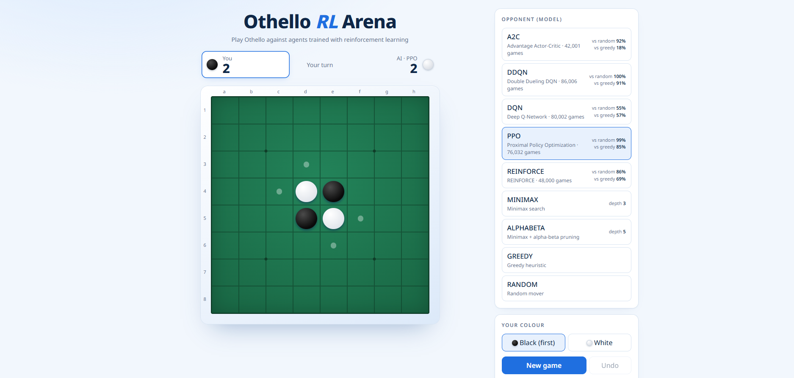

# Othello RL Arena

Play Othello against agents trained with **five reinforcement learning algorithms** (DQN, Double-Dueling DQN, REINFORCE, A2C, PPO) and two classic search opponents (**Minimax** and **Alpha-Beta**) — in a web app, in the terminal, or watch them play each other.



## Features

- **5 RL agents** trained from scratch by self-play with a shared ResNet policy/value network
- **Minimax and Alpha-Beta** opponents with adjustable search depth
- **Web app** (Flask): pick an opponent and your colour, see legal moves, undo, show model hints (per-move scores)
- **Fast training**: vectorised numpy bitboard environment (6,000–12,000 games/s), GPU replay buffer, all algorithms trainable in parallel
- **Live training monitor**: progress, win-rate curves, GPU stats and evaluation-game replay
- **Tournament script** that pits every agent against every other

## Opponents

Win rates measured during training (400 evaluation games, colours alternating):

| Agent | Type | Training games | vs Random | vs Greedy |
|---|---|---|---|---|
| DDQN | Double Dueling DQN | 86,006 | 100% | 91% |
| PPO | Proximal Policy Optimization | 76,032 | 99% | 85% |
| REINFORCE | Monte-Carlo policy gradient | 48,000 | 86% | 69% |
| A2C | Advantage Actor-Critic | 42,001 | 92% | 18% |
| DQN | Deep Q-Network | 80,002 | 55% | 57% |
| Minimax | Search, depth 3 (configurable) | – | – | – |
| Alpha-Beta | Search with pruning, depth 5 (configurable) | – | – | – |
| Greedy / Random | Baselines | – | – | – |

## Quick start

```powershell
py -3.12 -m venv .venv
.\.venv\Scripts\activate
pip install -r requirements.txt
python app.py                       # open http://127.0.0.1:5000
```

Trained weights are in `weights/`, so you can play immediately without training.

> `requirements.txt` installs PyTorch built for CUDA 12.8 (needed for RTX 50-series cards). On a CPU-only machine or server, remove the `--extra-index-url` line, or install the CPU wheel from `https://download.pytorch.org/whl/cpu`.

## Playing

```powershell
python app.py                       # website
python app.py --device cuda         # compute the AI's moves on the GPU
python play.py --black human --white ppo        # terminal game (type moves such as d3)
python play.py --black ppo --white dqn --games 100
python play.py --black human --white alphabeta --depth 6
python play.py --black minimax:3 --white alphabeta:5 --games 10
```

On the website, choose **MINIMAX** or **ALPHABETA** in the opponent list to see how many positions the search visited and how long it took. "Show model hints" shows the score of every legal move (`WIN` / `LOSS` once the search reaches the end of the game).

## Training

```powershell
python training.py --algo all --device cuda --parallel     # all 5 at once on the GPU (fastest)
python training.py --algo ppo,a2c --device cpu             # a subset on the CPU
python training.py --algo dqn --games 200000 --resume      # continue a previous run
```

- `--device auto` uses CUDA when available, otherwise the CPU
- Default: 50,000 self-play games per algorithm
- Best weights → `weights/<algo>.pt`, latest → `weights/<algo>_last.pt`
- Progress → `logs/<algo>_status.json` and `logs/<algo>.jsonl`
- All options: `python training.py --help`

### Speed optimisations

| Technique | Option | Effect |
|---|---|---|
| Vectorised multi-env (numpy bitboards) | `--n-envs` | Environment goes from ~350 to 6,000–12,000 games/s |
| Parallel evaluation | `--eval-games` | 400 evaluation games in under a second |
| One process per algorithm | `--parallel` | Better GPU / CPU utilisation |
| Replay buffer kept on the GPU (DQN) | automatic | No CPU→GPU copy per batch |
| Fused Adam, cudnn.benchmark, fewer syncs | automatic on CUDA | ~20% |
| bf16 mixed precision | `--amp` | Off by default: slower for this small network on an RTX 5070 |
| CPU threads per process | `--threads` | `--parallel` on CPU splits threads automatically |

On an RTX 5070, DQN alone ran at ~17 games/s; all five algorithms with `--parallel` reach ~290 games/s combined.

### Training monitor

```powershell
python monitor.py                   # opens http://127.0.0.1:5000/monitor
```

- Start / stop training from the page (algorithms, GPU or CPU, number of games, parallel, resume, amp)
- One card per algorithm: status, progress, games/s, time left, win rates, loss
- Charts for win rate, speed and metrics (loss, entropy, epsilon, value loss, KL)
- GPU status, replay of the latest evaluation game, and console output
- Runs started from the terminal with `training.py` are shown too

## Configuration (`.env`)

Copy `.env.example` to `.env`. Real environment variables take precedence, and changes apply without restarting the server.

| Setting | Default | Effect |
|---|---|---|
| `MINIMAX_DEPTH` | `3` | Search depth (1–8) of the Minimax opponent |
| `ALPHABETA_DEPTH` | `5` | Search depth (1–8) of the Alpha-Beta opponent |
| `ENABLE_TRAINING_MONITOR` | `true` | Show the Training Monitor page and its start/stop APIs. `false` hides the link and returns 404 for them. **Set to `false` on a public deployment.** |

Accepted boolean values: `true` / `false`, `1` / `0`, `yes` / `no`, `on` / `off`.

## Deploying to a small server

The game itself is light. On a 4-core CPU such as an i5-6500 with 4 GB RAM:

- RL agents answer in roughly 5–15 ms per move (CPU inference)
- Alpha-Beta at depth 5 takes about 0.1–0.5 s per move; depths 7–8 can take many seconds, so keep the depth low
- The web app needs roughly 0.5–1 GB RAM

Use the CPU build of PyTorch, run with `--device cpu`, set `ENABLE_TRAINING_MONITOR=false`, and train elsewhere — copy only the `weights/` folder to the server.

### Deploy with Dokploy (GitHub + Docker)

The repo includes a `Dockerfile` (CPU-only PyTorch, gunicorn on port 8000) and `requirements-server.txt`.

1. Push the repo to GitHub, including `weights/*.pt` (the `*_last.pt` checkpoints are git-ignored).
2. In Dokploy create an **Application**, choose **GitHub** as the source, select the repository and branch, and set **Build Type** to `Dockerfile`.
3. Under **Domains** add your domain with container port `8000`.
   The image is tuned for a 4-core / 4 GB host such as an i5-6500: 3 gunicorn workers (`WEB_CONCURRENCY`) with one torch thread each. Dokploy itself uses about 1 GB, so leave `WEB_CONCURRENCY` at 3 or lower.
4. Under **Environment** you can override `MINIMAX_DEPTH`, `ALPHABETA_DEPTH` (the image defaults to 3 and 5) — keep `ENABLE_TRAINING_MONITOR=false`.
5. Enable **Auto Deploy** so each push to the branch redeploys (this uses the Dokploy GitHub App, no extra setup).


Test the image locally with `docker build -t othello-rl .` and `docker run -p 8000:8000 othello-rl`.

## Classic search opponents

Both use **negamax** on bitboards: a position is worth *v* to the player to move and *−v* to the opponent.

- **Minimax** examines every move down to the chosen depth.
- **Alpha-beta pruning** returns exactly the same values but skips branches the opponent would never allow. Moves are ordered by square value (corners first) so cut-offs happen early.
- **Evaluation** at the horizon: square weights + 5 × mobility (difference in legal moves). Finished games score ±10,000 + disc difference.
- **Passes** are handled: if the player to move has no legal move, the opponent moves again; two passes end the game.

Measured at depth 4 on random positions:

| Game stage | Minimax | Alpha-beta |
|---|---|---|
| Opening (ply 4) | 2,478 positions / 46 ms | 690 positions / 12 ms |
| Midgame (ply 20) | 28,462 positions / 575 ms | 3,971 positions / 78 ms |
| Late (ply 40) | 16,129 positions / 331 ms | 4,908 positions / 96 ms |

## How the RL agents work

- One network plays both colours. The observation is the board from the point of view of the player to move (own stones / opponent stones / legal moves).
- Reward is +1 for a win, −1 for a loss, 0 for a draw, given at the end of the game.
- Othello is zero-sum, so bootstrapped values change sign when the turn passes to the opponent (negamax) and keep their sign when the opponent has to pass.
- **DQN / DDQN**: replay buffer, target network, augmentation with the board's 8 symmetries.
- **REINFORCE**: Monte-Carlo returns, one gradient step per batch of games.
- **A2C**: n-step rollouts with GAE, one gradient step per rollout.
- **PPO**: GAE with a clipped objective over several epochs and KL early stopping.
- Moves are sampled with the Gumbel-max trick, because `torch.multinomial` on CUDA can occasionally pick a zero-probability (illegal) move.

## Testing

```powershell
python -m pytest test.py -q          # unit tests
python test.py --games 400           # tournament: every model vs random, greedy, minimax, alpha-beta and each other
python test.py --no-search           # faster: leave the (sequential) search agents out
python test.py --search-games 20 --alphabeta-depth 6
```

## Project layout

| File | Purpose |
|---|---|
| `env.py` | Othello rules on bitboards, gym-style API: `reset()`, `step()`, `legal_moves()` |
| `vec_env.py` | Vectorised multi-env: steps N games at once with numpy uint64 bitboards |
| `agents.py` | ResNet model, weight save/load, Random / Greedy / Neural agents |
| `search.py` | Minimax and Alpha-Beta opponents |
| `training.py` | Self-play training: DQN, DDQN, REINFORCE, A2C, PPO |
| `play.py` | Terminal play (human vs AI or AI vs AI) |
| `test.py` | Unit tests and tournament |
| `app.py`, `web/` | Flask website: game page `/` and training monitor `/monitor` |
| `monitor.py` | Opens the training monitor in your browser |
| `weights/`, `logs/` | Trained models and training logs |
